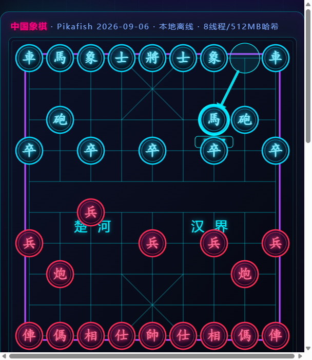
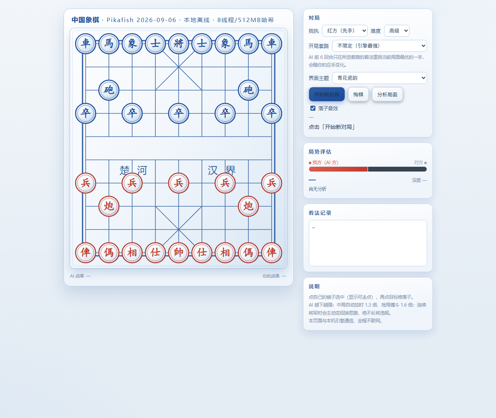
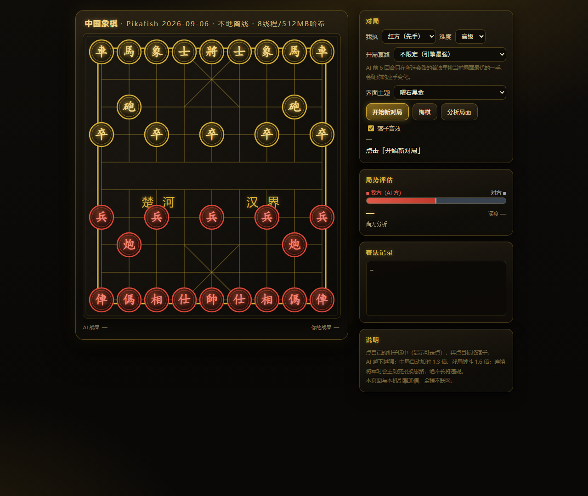
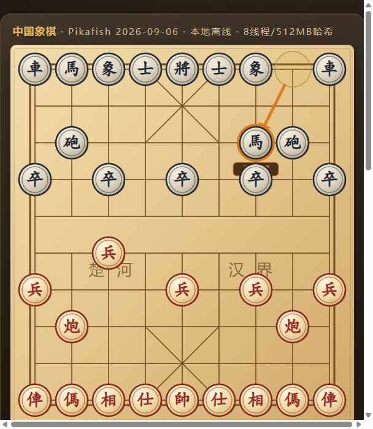
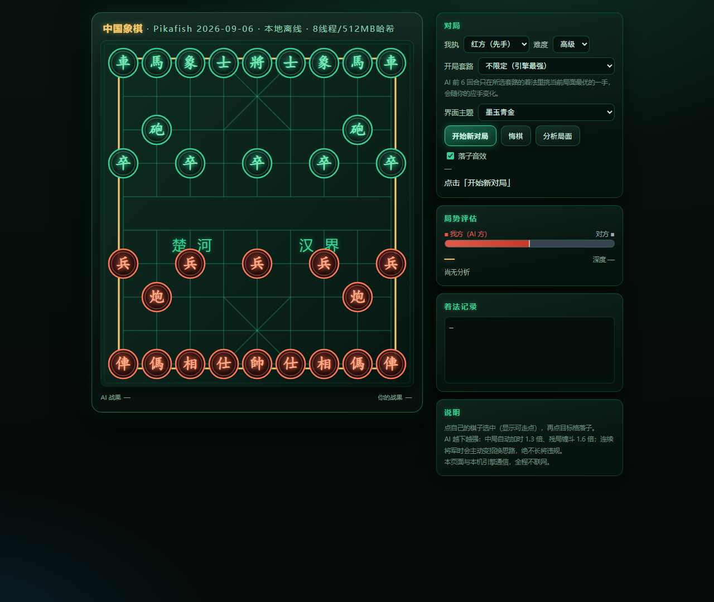
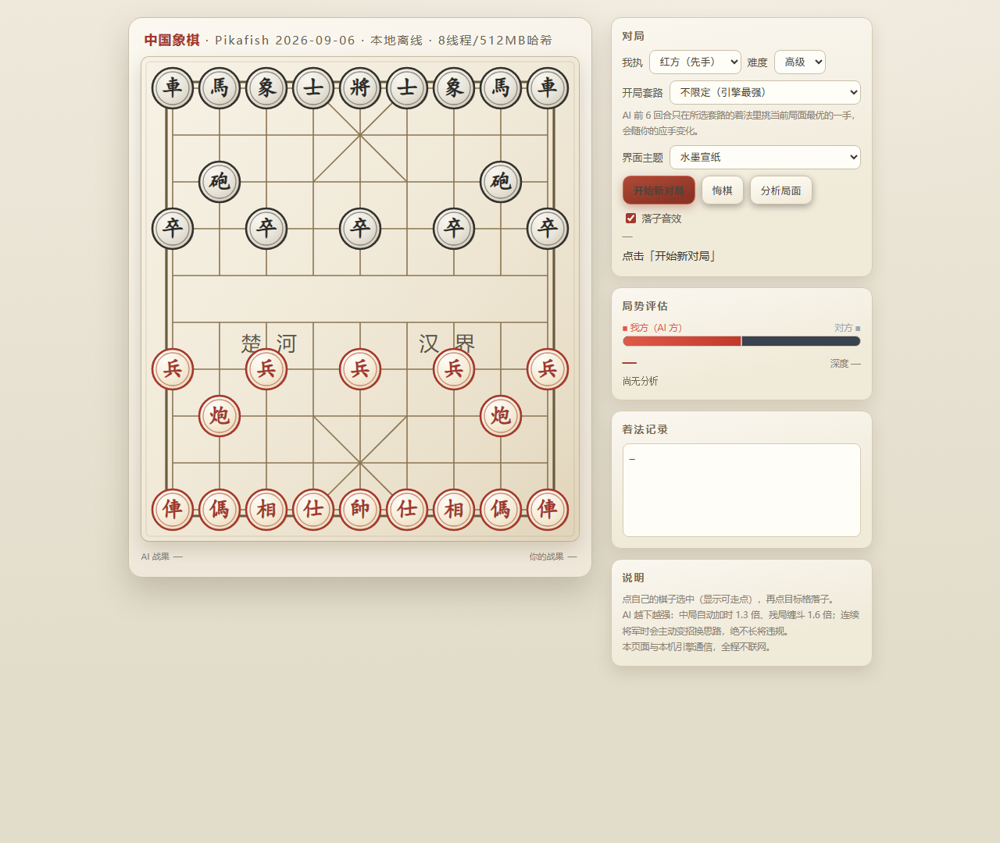

<div align="center">

# 中国象棋 AI · Pikafish + Web GUI

**本地离线运行的中国象棋对弈程序**<br>
顶级引擎 · 5.1 万节点职业开局库 · 可点击候选着法 · 赛博美学

[](../../releases)
[](https://www.python.org/downloads/)
[](../../releases)
[](#许可)
[](../../stargazers)

**[English README](README_EN.md)** · [下载即用版](../../releases) · [使用说明](usage.md)

</div>



<details>
<summary>更多主题截图（共 8 套，点击展开）</summary>

| 樱花粉雪 | 青花瓷韵 |
|---|---|
|  |  |
| **暗夜紫罗** | **曜石黑金** |
|  |  |
| **经典木纹** | **墨玉青金** |
|  |  |
| **水墨宣纸** | |
|  | |

</details>

## 功能

| 类别 | 说明 |
|------|------|
| **强引擎** | Pikafish 2026-09-06，8 线程 / 512MB 哈希，五档难度（默认高级 2s/步，随对局深入自动加时，越下越强） |
| **职业开局库** | 由 Eleeye BOOK.DAT 翻译的 51,101 节点开局树，按职业比赛统计权重选着，零延迟 |
| **AI 候选着法** | 每步给出前 3 候选（中文记谱 + 我方视角分差 + 续着），**点击候选即可让 AI 改走该手** |
| **局势评估卡** | 白话结论（我方略优 / 对方大优…）+ 红方视角形势条 + 中文主变 |
| **规则完备** | 长将/长捉违规判定、三次重复局面、六十回合和棋 |
| **美术** | 8 套主题随时切换（赛博霓虹/经典木纹/墨玉青金/水墨宣纸/青花瓷韵/暗夜紫罗/曜石黑金/樱花粉雪，支持 `?theme=xxx` 链接直达），落子滑行动画、吃子碎裂特效、将军/绝杀全屏横幅、走子路径箭头、战损陈列区、落子音效 |
| **套路模式** | AI 按指定开局套路（中炮、飞相、仙人指路等）见招拆招 |

## 快速开始（Windows）

**前提**：安装 [Python 3.8+](https://www.python.org/downloads/)（安装时务必勾选 **Add python.exe to PATH**）。无需安装任何第三方包。

**方式一（推荐，免装 git）**：到 [Releases](../../releases) 下载 zip，解压到任意目录，双击 `开始下棋.bat`。

**方式二（克隆源码）**：

```bat
git clone https://github.com/rallait/xiangqi-pikafish-web.git
cd xiangqi-pikafish-web
开始下棋.bat
```

浏览器会自动打开 <http://127.0.0.1:8731>（如未自动打开请手动访问）。关闭黑色命令行窗口即退出程序。

## 职业开局库格式（可复用）

`gui-web/book_tree.json` 由 Eleeye 的 `BOOK.DAT` 转换而来（转换脚本 `build_book.py`），结构极简，任何象棋程序都可以直接复用：

```json
{
  "":            {"c3c4": 546, "b2e2": 1473, "c0e2": 311, ...},
  "c3c4":        {"h9g7": 50, "b7c7": 149, "g6g5": 57, ...},
  "c3c4 h9g7":   {"g3g4": 34, "b0c2": 38, ...}
}
```

- **key**：从开局到当前局面的着法序列，UCI 坐标着法（如 `h2e2` = 炮二平五），空格分隔；空串 `""` 是初始局面
- **value**：`{下一着: 权重}`，权重来自 Eleeye 职业比赛对局统计，可按权重随机/排序选着
- 查询方式：把当前着法序列作为 key 直接查表，命中即出开局库，未命中走引擎

坐标系约定：`a0` 为棋盘左下角（红方视角），列 `a-i`，行 `0-9`，与 Pikafish 一致。

## 目录结构

```
engine/          Pikafish 引擎（Windows/Linux/macOS/Android 二进制 + NNUE 权重 + 官方许可）
gui-web/         Web 界面与服务端
  index.html     单文件前端（棋盘 SVG、规则引擎、动画特效、主题系统）
  server.py      HTTP 服务 + UCI 引擎桥接（开局库、MultiPV 候选、长将排除）
  book_tree.json 职业开局库（51,101 节点，由 BOOK.DAT 生成）
  build_book.py  BOOK.DAT → book_tree.json 转换脚本
docs/            界面截图
开始下棋.bat     一键启动
usage.md         使用说明
install-log.md   安装与来源校验记录（URL / SHA256）
offline-test.md  离线验证记录
```

## 许可

- Pikafish 引擎与 NNUE 权重：GPL-3.0（见 `engine/Copying.txt`、`engine/NNUE-License.md`）
- 开局库源数据 BOOK.DAT 来自 Eleeye（GPL）
- 本仓库自研代码（gui-web、脚本、文档）：MIT
